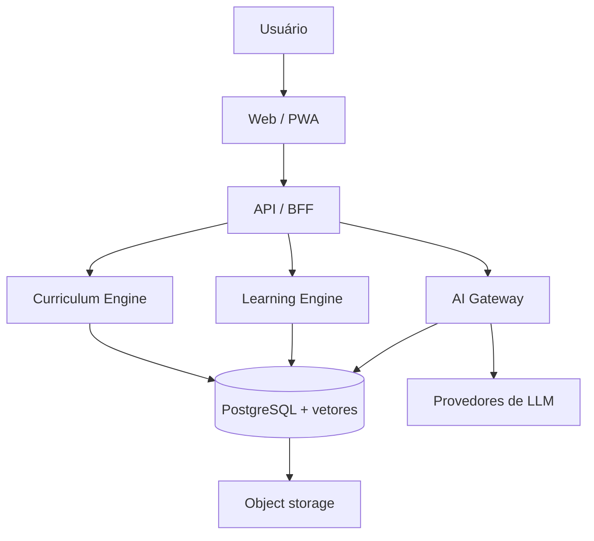

# Arquitetura de referência

## Decisão

Começar com um **monólito modular**, preservando limites de domínio para extração futura. Microserviços elevariam prematuramente custo, DevOps, observabilidade e risco de falhas distribuídas.

## Fluxo

## Módulos

- `auth`: identidade, RBAC e tenancy;
- `curriculum`: instituição, curso, disciplina, conteúdo e objetivos;
- `competencies`: grafo de competências;
- `rag`: ingestão, indexação, busca e reranking;
- `tutor`: política pedagógica e orquestração da resposta;
- `learning`: evidências, domínio e revisão adaptativa;
- `assessments`: diagnóstico e avaliações formativas;
- `analytics`: eventos e painéis;
- `security`: guardrails, auditoria e isolamento;
- `ai-gateway`: abstração dos provedores de modelo;
- `database`: persistência, migrações e vetores.

## Pipeline RAG

Autenticar → identificar tenant/curso/disciplina/conteúdo/competência → buscar apenas fontes aprovadas → reranquear → aplicar política pedagógica → consultar modelo → validar resposta/citações/segurança → apresentar e registrar.

## Hierarquia de fontes

Professor → disciplina → curso → instituição → referências externas autorizadas. Conteúdo externo nunca substitui silenciosamente a orientação do professor.
